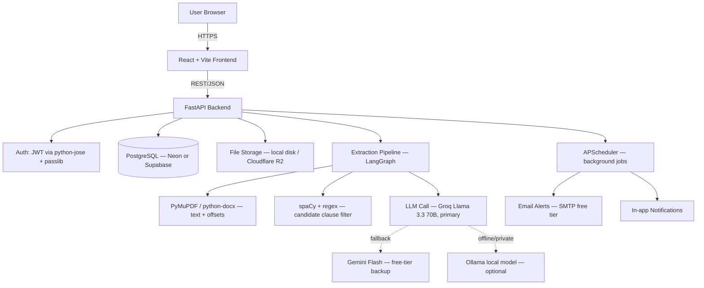

# Technical Requirements Document (TRD)
## Plain-Language Obligation Tracker

| Field | Value |
|---|---|
| **Project** | Plain-Language Obligation Tracker |
| **Document Type** | Technical Requirements Document |
| **Status** | Draft v1.0 |
| **Governing Constraint** | Every component must run at **$0** using open-source software and/or standing free tiers — see `constraint.md` |
| **Companion Docs** | `PRD.md` (requirements this implements) · `rules.md` · `constraint.md` · `blueprint.md` |

> Cloud free-tier limits change often. The specific numbers in this document were checked in September 2026 and are accurate as of that date — reconfirm each provider's current terms before you depend on them, especially close to a demo.

---

## 1. Architecture Overview



**Layers, plainly stated:**
1. **Frontend** — a React SPA that renders the document viewer, verification UI, task board, and calendar.
2. **Backend API** — a single FastAPI service that owns auth, business logic, the extraction pipeline, and scheduling.
3. **Extraction pipeline** — a multi-step process (parse → filter → classify/extract → score → cite) orchestrated as a graph, not a single black-box LLM call.
4. **Data layer** — PostgreSQL for everything transactional; a file store for uploaded contracts and evidence.
5. **Notification layer** — a scheduler that checks upcoming due dates and fires email + in-app alerts.

---

## 2. Technology Stack

Every row below is $0 to start. "Primary" is the default recommendation; "Alternative" is a documented fallback if a limit is hit or a preference differs.

### 2.1 Frontend

| Concern | Primary Choice | Notes |
|---|---|---|
| Framework | **React** (via Vite) | Matches the original proposal; Vite gives faster local builds than Create React App, MIT-licensed, free |
| Styling | **Tailwind CSS** | Free, avoids hand-rolling CSS for a two-panel verification layout |
| PDF rendering + highlight overlay | **pdf.js** (via `react-pdf`) | Open source (Apache-2.0), needed to render the original document and draw highlight boxes over extracted spans (FR-2.2) |
| Calendar UI | **react-big-calendar** (MIT) | Renders the obligation calendar (FR-4.1) without external dependencies |
| State/data fetching | **TanStack Query** + React state | Free, handles async extraction status polling cleanly |

### 2.2 Backend

| Concern | Primary Choice | Notes |
|---|---|---|
| API framework | **FastAPI** (Python) | Per proposal; free, async-native, auto-generates OpenAPI docs |
| ORM / migrations | **SQLAlchemy 2.0 + Alembic** | Free, standard, versioned schema changes |
| Auth | **python-jose (JWT) + passlib[bcrypt]** | Rolls your own auth inside FastAPI rather than depending on a third-party auth service — zero cost, full control, matches FR-5.2 |
| Background jobs / scheduling | **APScheduler** (in-process) | Free, no extra infrastructure (Redis/Celery) needed at capstone scale — runs due-date checks and alert dispatch on a cron-like schedule inside the same process |
| Document parsing | **PyMuPDF (fitz)** for PDF, **python-docx** for Word | Both open source; PyMuPDF preserves page/character offsets required for citation + highlighting (FR-1.2) |
| Candidate clause filtering | **spaCy** + regex + `dateparser` | Free, open source, cheap CPU-only pre-filter that reduces how much text ever reaches the LLM step |

### 2.3 LLM / Extraction Layer

| Concern | Primary Choice | Notes |
|---|---|---|
| Pipeline orchestration | **LangGraph** | Already in your working stack — a natural fit for a multi-step, stateful pipeline (parse → filter → extract → score → route to review) rather than one large prompt |
| LLM inference | **Groq — Llama 3.3 70B** (or current-best Groq-hosted open model) | Already in your working stack. No credit card required to start; free tier is fast (custom inference hardware) with per-model rate limits (roughly 30 requests/minute, with daily and token-per-minute caps that vary by model). More than sufficient for clause-level extraction calls on a filtered candidate set. **Check `console.groq.com` for the current model lineup before building** — Groq periodically retires/adds models. |
| Fallback LLM | **Google Gemini API (Flash / Flash-Lite)** free tier | As of April 2026, Gemini's free tier covers **Flash and Flash-Lite only** (Pro is trial-only). Useful as a second provider if Groq's daily cap is hit during heavy testing. |
| Local/offline/privacy option | **Ollama** running Llama 3.1 8B or similar, on your own machine | $0 forever, no rate limits, keeps contract text off any third-party API entirely — the strongest option if you're extracting from genuinely sensitive documents (see `rules.md`, R-3, on data handling) |
| Evaluation / accuracy testing | **DuckDB** | Already in your toolkit — a good fit for locally querying a labeled test set of extracted clauses (precision/recall scoring against ground truth) without standing up infrastructure for what is fundamentally a one-off analysis task |

### 2.4 Database & Storage

| Concern | Primary Choice | Notes |
|---|---|---|
| Database | **PostgreSQL via Neon** | Free tier: no card, no expiry, ~0.5 GB storage/project, ~100 compute-hours/month, autoscaling to 2 CU, up to 10 branches. Scales to zero when idle and **wakes automatically** within seconds on the next query — no manual "un-pause" step. |
| Database (bundled alternative) | **Supabase** | Free tier bundles Postgres (500 MB) + Auth + Storage (1 GB) + 5 GB egress in one dashboard — fewer moving parts if you'd rather not roll your own auth/storage. Trade-off: free projects **pause after 7 days of inactivity** and need a manual restore from the dashboard (data is preserved, just paused). |
| File storage (contracts, evidence) | **Local disk** during development; **Cloudflare R2** if you outgrow it | R2's free tier has historically included a meaningful amount of storage with no egress fees, which matters once evidence attachments accumulate — confirm current limits at signup |
| Do **not** use | Render's free Postgres for anything persistent | It's real Postgres, but the free instance **expires after 30 days** — fine for a throwaway test DB, wrong for the app of record |

### 2.5 Notifications

| Concern | Primary Choice | Notes |
|---|---|---|
| Email alerts | **Brevo (formerly Sendinblue) free tier** or **Resend free tier** | Both offer a genuinely free daily send allowance sufficient for a small organization's alert volume; avoids relying on a personal Gmail SMTP account, which has stricter automated-sending limits. **Decision (2026-11-03): Resend selected.** |
| In-app notifications | Built in-app (own table + endpoint) | No external service needed |

### 2.6 Hosting & Ops

| Concern | Primary Choice | Notes |
|---|---|---|
| Frontend hosting | **Vercel** or **Cloudflare Pages** free tier | Static React build, auto-deploy from GitHub, free custom domain support |
| Backend hosting | **Render** free web service | 750 instance-hours/month, 100 GB bandwidth, 500 build minutes. Spins down after ~15 minutes idle and cold-starts on the next request (a few seconds delay) — acceptable for a capstone demo, documented as a known limit in `constraint.md` |
| Backend hosting (advanced alternative) | **Oracle Cloud "Always Free" VM** | Historically offers a genuinely persistent free Ampere ARM VM (no cold starts). Oracle has reportedly scaled back the exact core/RAM allocation for some accounts during 2026 — **verify what your account is actually offered at signup** rather than assuming a fixed spec. Only worth the extra setup complexity if Render's cold start is a real problem for your demo. |
| Containerization | **Docker + docker-compose** | Free, makes local dev and any VM deployment reproducible. **Decision (2026-11-03):** Docker is *optional/deferred* for this project — local dev connects directly to a Neon dev database instead, so no Docker Desktop install is required on the dev machine. Containerization can be added later only if a VM deployment (Oracle stretch) needs it. |
| CI/CD | **GitHub Actions** | Free minutes for both public and (within limits) private repos |
| Source control | **GitHub** (free) | Also where `rules.md` conventions apply |

---

## 3. NLP/LLM Extraction Pipeline (Detail)

This is the technical core of FR-1 and directly implements the "citation capabilities for accurate extraction" requirement from the original proposal.

```
1. INGEST      → PyMuPDF/python-docx extract raw text + page/char offsets
2. CHUNK       → split into paragraph/clause-level chunks, offsets preserved
3. FILTER      → spaCy + regex + dateparser flag chunks likely to contain an
                 obligation (keywords: "renew", "terminate", "notice",
                 "shall provide", "expiration"; explicit date patterns)
                 — this step is free and CPU-only, and exists specifically
                 to keep LLM calls (and therefore rate-limit usage) low
4. EXTRACT     → filtered candidates sent to the LLM (Groq, primary) with a
                 structured-output prompt requesting: obligation_type,
                 plain_language_summary, key_dates, responsible_party
                 (if inferable), and a self-reported confidence
5. SCORE       → composite confidence = LLM confidence + rule-based signal
                 (e.g., did step 3 also find an explicit date?) — the LLM's
                 own confidence is never trusted alone
6. CITE        → every extracted item stores the source chunk's page number
                 and character offset range — this is what makes highlighting
                 possible in FR-2.2, and what makes the output verifiable
                 rather than a bare assertion
7. HOLD        → nothing is written to the Obligations table until a human
                 accepts it in the Verification UI (FR-2.4 / rules.md R-2)
```

LangGraph is a natural fit for orchestrating steps 3–6 as a stateful graph: a filter node, an extract node, a score node, and a conditional edge that routes low-confidence extractions differently (e.g., a stronger visual flag in the UI) than high-confidence ones — cleaner than one long procedural function, and it's already a tool you work with.

**Why extraction is never fully automatic:** this pipeline is deliberately built to produce *candidates for human review*, not final answers. That is a product requirement (PRD.md, FR-2.4), not just an engineering choice — see `rules.md`, R-1 and R-2.

---

## 4. Data Model

Core entities (PostgreSQL, all relationships via foreign key):

```
Organization
 ├── id, name, created_at

User
 ├── id, organization_id (FK), email, password_hash, role (admin|member), created_at

Document
 ├── id, organization_id (FK), uploaded_by (FK → User), filename,
 │   storage_path, mime_type, version, uploaded_at

ExtractedClause
 ├── id, document_id (FK), obligation_type, plain_language_text,
 │   raw_source_text, page_number, char_start, char_end,
 │   confidence_score, status (pending|accepted|edited|rejected),
 │   created_at

Obligation                      -- created only on human acceptance
 ├── id, document_id (FK), extracted_clause_id (FK, nullable),
 │   obligation_type, description, citation_page, citation_offset,
 │   created_by (FK → User), verified_at

Task
 ├── id, obligation_id (FK), title, description, due_date,
 │   recurrence_rule (nullable), owner_id (FK → User),
 │   status (open|in_progress|done), created_at, updated_at

EvidenceAttachment
 ├── id, task_id (FK), storage_path, uploaded_by (FK → User), uploaded_at

Notification
 ├── id, task_id (FK), channel (email|in_app), lead_time_days,
 │   scheduled_for, sent_at (nullable), status

AuditLog
 ├── id, organization_id (FK), actor_id (FK → User), entity_type,
 │   entity_id, action, timestamp
```

**Design notes:**
- `ExtractedClause` and `Obligation` are deliberately separate tables. The former is provisional AI output; the latter only ever contains human-verified data. This separation is what makes R-2 in `rules.md` enforceable at the schema level, not just by convention.
- `citation_page` / `citation_offset` are carried onto `Obligation` (not just `ExtractedClause`) so a verified obligation remains traceable to its source even if the original extraction record is later pruned.
- `recurrence_rule` on `Task` uses a simple string convention (e.g., `"yearly"`, `"none"`) rather than a full RFC 5545 RRULE — sufficient for the recurrence patterns contracts actually need (see PRD.md, Open Questions).

---

## 5. API Design (REST, FastAPI)

| Resource | Endpoints |
|---|---|
| **Auth** | `POST /auth/register` · `POST /auth/login` · `POST /auth/refresh` |
| **Organizations** | `GET /orgs/me` · `POST /orgs/invite` |
| **Users** | `GET /users` · `PATCH /users/{id}/role` |
| **Documents** | `POST /documents` (upload) · `GET /documents` · `GET /documents/{id}` · `DELETE /documents/{id}` · `POST /documents/{id}/extract` (trigger pipeline) · `GET /documents/{id}/status` (poll extraction progress) |
| **Clauses** | `GET /documents/{id}/clauses` · `PATCH /clauses/{id}` (accept/edit/reject) |
| **Obligations** | `GET /obligations` · `GET /obligations/{id}` |
| **Tasks** | `POST /tasks` · `GET /tasks` (filterable by status/owner/date) · `PATCH /tasks/{id}` · `POST /tasks/{id}/evidence` |
| **Calendar** | `GET /calendar?from=&to=` (tasks + obligations in range) |
| **Notifications** | `GET /notifications` · `PATCH /notifications/{id}/read` · `PATCH /notifications/preferences` |

All endpoints (except `/auth/*`) require a valid JWT and are scoped to the caller's `organization_id` server-side — never trust an org ID passed from the client.

---

## 6. Non-Functional Requirements

| Category | Requirement |
|---|---|
| **Performance** | Extraction of a typical 10–20 page contract completes in well under 60 seconds end-to-end at Groq's free-tier speed; the UI must remain responsive during processing (async job + status polling, not a blocking request) |
| **Security** | Passwords hashed with bcrypt; JWTs short-lived with refresh; all document/evidence storage access-checked against the requester's organization; no organization can read another's data |
| **Privacy** | Contract text sent to a third-party LLM API (Groq/Gemini) is a real privacy consideration for legal documents — see `rules.md` R-3 for handling rules, and the Ollama local-model option in Section 2.3 if a document is too sensitive to send externally |
| **Reliability** | If the primary LLM provider errors or rate-limits, the pipeline should fail a single document gracefully (mark it "extraction failed, retry") rather than crash the whole request queue |
| **Scalability** | Explicitly out of scope for v1 — see `constraint.md`. Free-tier infrastructure is not sized for production multi-tenant load, and that's an accepted trade-off, not an oversight |
| **Accessibility** | Basic WCAG AA hygiene: sufficient color contrast, keyboard-navigable verification UI, alt text on icons |

---

## 7. Deployment Topology

```
GitHub repo
   │
   ├── GitHub Actions (CI: lint, test, build) — free
   │
   ├── Frontend → Vercel/Cloudflare Pages (free) — auto-deploy on push
   │
   └── Backend  → Render free web service (free) — auto-deploy on push
                     │
                     ├── PostgreSQL → Neon (free, separate service)
                     └── File storage → local disk (Render) or R2 (free)
```

**Known operational caveat to design around:** both Render's free web service (idle spin-down) and Neon's scale-to-zero (idle suspend) introduce a cold-start delay after inactivity. Neither loses data — it's a latency issue, not a durability one — but a demo run immediately after a period of inactivity should account for a few seconds' delay on the first request. `blueprint.md` includes a pre-demo "warm-up" step for exactly this reason.

---

## 8. Testing Strategy

| Layer | Tooling | Notes |
|---|---|---|
| Backend unit/integration | **pytest** + `httpx` (async test client) | Cover extraction pipeline steps independently of the LLM call (mock the LLM response) so tests are fast and don't burn API quota |
| Extraction accuracy | **DuckDB** + a hand-labeled test set of clauses | Load extraction output + ground-truth labels, compute precision/recall directly against the Section 8 targets in `PRD.md` |
| Frontend unit | **Vitest** + React Testing Library | Free, fast, Vite-native |
| End-to-end | **Playwright** (free, open source) | Script the full upload → verify → task → alert flow at least once before each milestone demo |

---

## 9. Dependency & License Reference

| Library | License | Cost |
|---|---|---|
| React, Vite | MIT | Free |
| FastAPI | MIT | Free |
| SQLAlchemy, Alembic | MIT | Free |
| PostgreSQL | PostgreSQL License (permissive) | Free |
| spaCy | MIT | Free |
| PyMuPDF | AGPL-3.0 (or commercial) | Free for this use; note the AGPL terms if the code is ever distributed rather than only run as a service |
| LangGraph | MIT | Free |
| Ollama | MIT | Free |
| pytest, Playwright, Vitest | MIT / Apache-2.0 | Free |

> PyMuPDF's AGPL license is the one entry worth a second look before any future commercialization — it's free and unrestricted for running this as your own service, but AGPL has specific obligations if you ever redistribute the software itself.

---

## 10. Cross-References

- Business/behavioral rules governing this architecture: `rules.md`
- Full constraint list (budget, timeline, hardware, data privacy): `constraint.md`
- Phased build order and folder structure: `blueprint.md`
